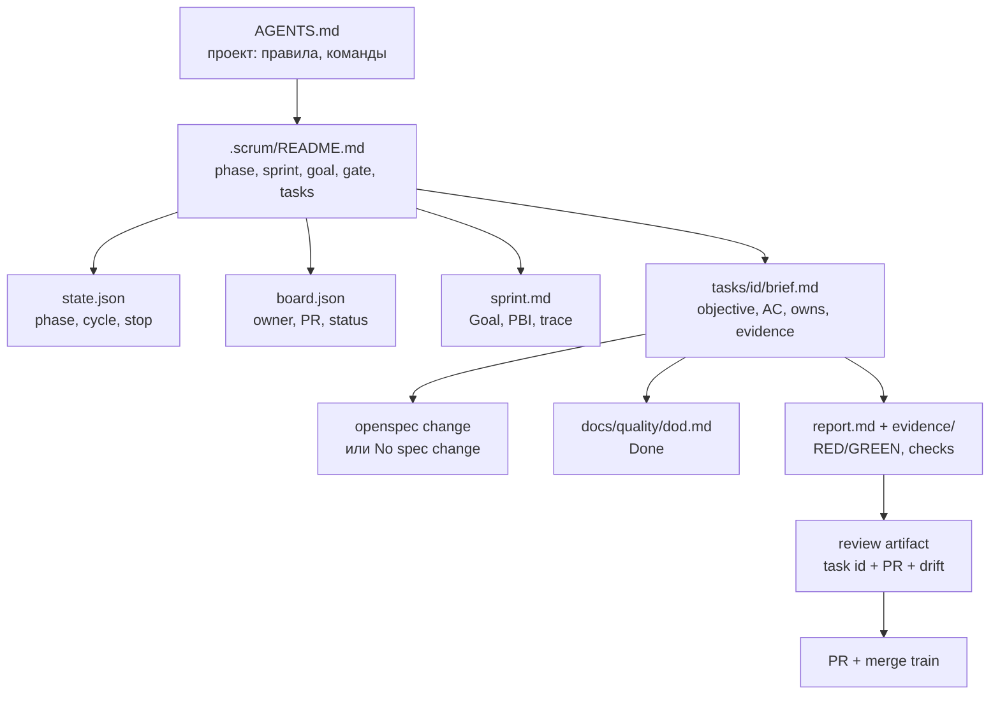
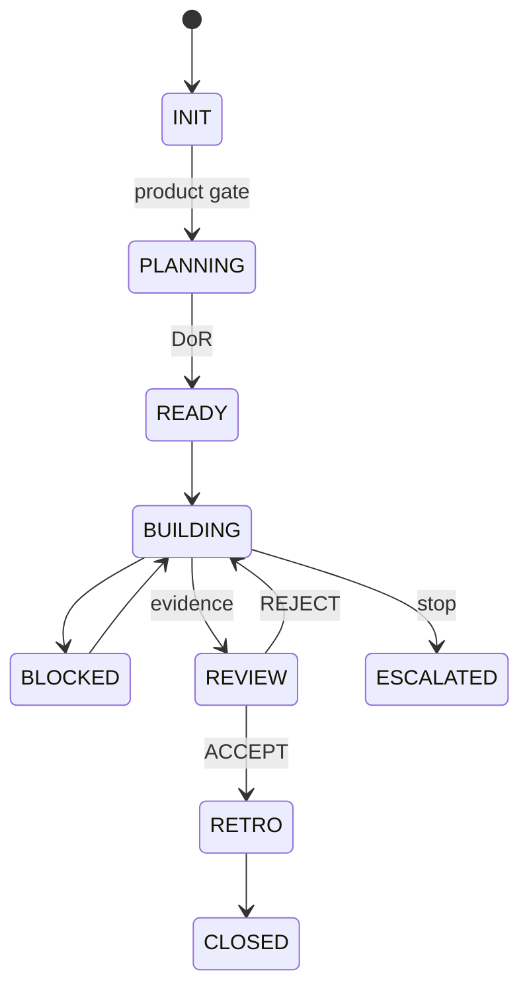
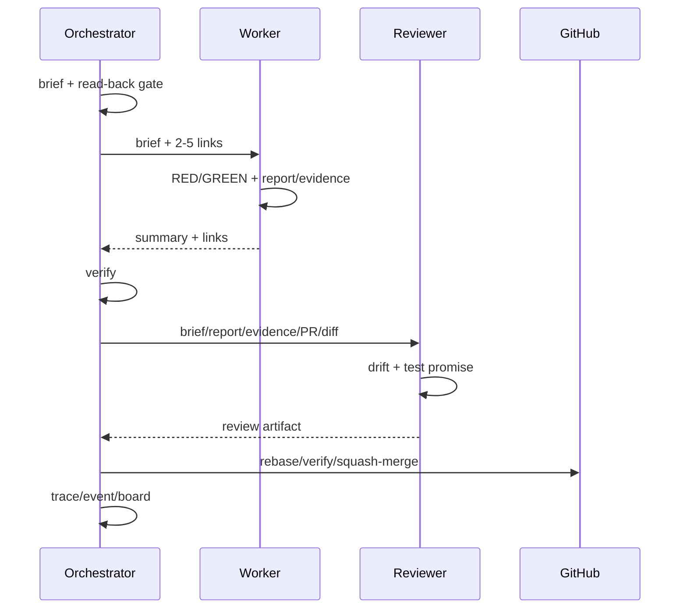

# Схема работы scrum-crew

Карта, не склад. Детали — в `references/` скилла; здесь — связи между
входом, циклом, задачей и артефактами.

## 1. Вход и контекст

- Навигация — два уровня: `AGENTS.md` (проект) → `.scrum/README.md`
  (спринт). Задача — `brief.md`, контекстный пакет.
- `.scrum/README.md` пишет только SM/оркестратор на границах фаз; stale
  phase или битая ссылка — провал гейта.
- Ответ нового агента — ≤ 3 ссылки: README → brief → change/`No spec
  change`; evidence лежит по ссылке из brief/report.

## 2. Цикл

- Спринт = 4–6 циклов по 60–90 минут; дейлик — на границе цикла.
- В работе 1–2 код-задачи; WIP 6 — потолок, не цель. Общие файлы и
  контракты — последовательно.
- Один мерж за раз; следующий PR — после зелёного `main`.

## 3. Задача

- Brief: objective, AC, owns, контракты, non-goals, output format,
  tools/sources, evidence, stop conditions. Без read-back задача не начата.
- Worker пишет `report.md`, `handoff.md`, `evidence/`; координатору —
  резюме ≤ 10 строк + ссылки.
- Reviewer читает артефакты, PR и diff, а не логи; проверяет drift и
  «обещание теста = ссылка на тест».

## 4. Артефакты и владельцы

| Артефакт | Путь | Владелец |
|---|---|---|
| Правила проекта | `AGENTS.md` | владелец/Architect |
| Карта спринта | `.scrum/README.md` | SM/оркестратор |
| Состояние | `.scrum/state.json`, `board.json`, `events.jsonl` | только оркестратор |
| Файл спринта | `.scrum/sprints/NN/sprint.md` | SM |
| Brief задачи | `.scrum/sprints/NN/tasks/<id>/brief.md` | оркестратор |
| Report / handoff / evidence | `.scrum/sprints/NN/tasks/<id>/` | worker |
| Review | `.scrum/reviews/NN-<task>.md` | reviewer |
| Поведение | `openspec/specs/`, `openspec/changes/` | PO/Architect/QA |
| Зачем / как / вид / проверка | `docs/concept`, `docs/stack`, `docs/design`, `docs/quality/` | владельцы зон |

## 5. Гейты

| Гейт | Что проверяется |
|---|---|
| Init | Goal, сценарий, метрика, non-goals; `verify`; preview; `.scrum/README.md` в `INIT` |
| Planning | DoR, change/`No spec change`, Tier, `openspec validate --strict` |
| Build | RED-evidence, `verify`, ревью не-автора, T2-артефакты текущей волны |
| Review | Done на preview, ATDD, drift, `No doc change`/host-doc, ACCEPT/REJECT |
| Close | `verify`, archive, trace полон, README → `CLOSED/done`, долг/postmortem закрыты |

Гейт — команда + exit code + evidence. «Зелёно» без вывода не
принимается.

## 6. Свежесть

- `status: plan|active|done|superseded`, `updated`, `owner`, `sprint`,
  `task`, `change`, `links` — в шапке артефакта.
- `plan` → `active` переводит PR реализации; `done` — после merge/verify.
- PR задачи: правка host-файла или `No doc change: <причина>`.
- Один факт — один файл; карта, sprint и review ссылаются, не копируют.

## 7. Что не читать

- `events.jsonl` как нарратив — только `tail`/`grep` по событию.
- Весь репозиторий, чужие task-папки, старые спринты.
- `/tmp`, чат и логи сессий как источник истины.
- Копии метрик, размеров и API — читай источник.

## Куда дальше

- Вход и контекст — `../.opencode/skills/scrum-crew/references/context.md`
- Оркестратор, WIP, merge train — `../.opencode/skills/scrum-crew/references/orchestrator.md`
- OpenSpec, статусы, drift — `../.opencode/skills/scrum-crew/references/openspec.md`
- Аудит и метрики — `../.opencode/skills/scrum-crew/references/audit.md`
- Шаблоны — `../.opencode/skills/scrum-crew/assets/sprint.md`,
  `brief.md`, `report.md`, `review.md`
- Raptor-поколения — `RAPTOR-SKILL.md`
